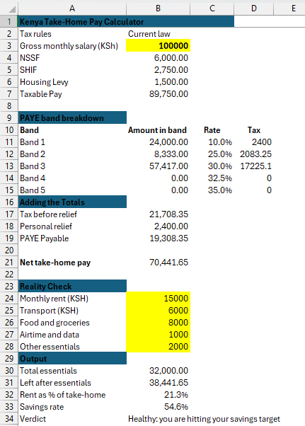

# Kenya Take-Home Pay Calculator

An Excel calculator that shows how a Kenyan employee's gross monthly salary becomes take-home pay. It works through NSSF, SHIF, the housing levy and PAYE **band by band**, then tests the result against rent and living costs.

It also has a **Current law / Proposed reform** switch, so you can compare today's PAYE rules with the PAYE changes announced by Treasury in 2026 (not yet law).

**Demo video (3 min):** [Watch on YouTube](https://youtu.be/kecHJSxp_AQ)

## Why I built it

A KSh 100,000 salary does not mean KSh 100,000 in your pocket. Many graduates only find out what they really take home when the first payslip arrives. I wanted a tool that shows the working at every step, so anyone can see where the deductions come from.

## How to use it

1. Download `Kenya_TakeHome_Calculator.xlsx`.
2. Open the **Calculator** sheet.
3. Choose **Current law** or **Proposed reform** in the *Tax rules* dropdown.
4. Type your gross monthly salary in the yellow cell.
5. Enter your monthly costs in the *Reality check* section to see what is left after essentials.

Only the yellow cells and the dropdown can be edited. The other cells are protected so the formulas stay intact.

## What it calculates

Deductions are applied in this order:

1. **NSSF:** 6% of pay, up to the upper earnings limit
2. **SHIF:** 2.75% of gross pay, minimum KSh 300
3. **Housing levy:** 1.5% of gross pay
4. **Taxable pay** = gross pay minus NSSF, SHIF and the housing levy
5. **PAYE** worked out on taxable pay by band, then reduced by personal relief
6. **Net take-home** = gross pay minus NSSF, SHIF, housing levy and PAYE

### Rates used (checked 24 November 2026)

| Item | Value |
|---|---|
| NSSF rate | 6% of pay, up to KSh 108,000 (maximum employee contribution KSh 6,480) |
| SHIF | 2.75% of gross pay, minimum KSh 300 |
| Housing levy | 1.5% of gross pay |
| Personal relief (current law) | KSh 2,400 a month |

### PAYE bands (monthly)

| Band | Current law | Proposed reform |
|---|---|---|
| 0 to 24,000 | 10% | 0% |
| 24,000 to 32,333 | 25% | 0% |
| 32,333 to 500,000 | 30% | 30% |
| 500,000 to 800,000 | 32.5% | 32.5% |
| Above 800,000 | 35% | 35% |
| Personal relief | KSh 2,400 | None |

## Example (KSh 100,000 gross)

| | Current law | Proposed reform |
|---|---|---|
| NSSF | 6,000.00 | 6,000.00 |
| SHIF | 2,750.00 | 2,750.00 |
| Housing levy | 1,500.00 | 1,500.00 |
| Taxable pay | 89,750.00 | 89,750.00 |
| PAYE payable | 19,308.35 | 17,225.10 |
| **Net take-home** | **70,441.65** | **72,524.90** |

### Test cases (current law)

| Gross salary | PAYE payable | Net take-home |
|---|---|---|
| 100,000 | 19,308.35 | 70,441.65 |
| 30,000 | 731.25 | 26,193.75 |
| 25,000 | 0.00 | 22,437.50 |

## About the proposed reform

The "Proposed reform" setting reflects news reports of Treasury's plan to set PAYE at zero on monthly income up to KSh 32,333 and to end personal relief, with the higher bands unchanged. **This is not law.** As of 24 November 2026 the Bill had not been passed, and its final wording may differ. The reform rates sit in their own column on the *Rates* sheet, so they are easy to update once the Bill is published.

## Limitations

- These are **estimates**, not tax advice.
- The model excludes pension contributions, mortgage interest, benefits in kind, insurance relief, loans and SACCO deductions.
- The rent and savings thresholds in the verdict are rules of thumb, not legal limits.
- The cost figures in the demo are examples, not real averages.
- Rates change. Always confirm against your payslip, KRA, the Social Health Authority and NSSF.

## Sources

- PAYE bands, personal relief and housing levy: Kenya Revenue Authority (KRA)
- SHIF rate and minimum: Social Health Authority (SHA)
- NSSF Year 4 rates (from February 2026): NSSF notice to employers, with tax alerts from PwC Kenya and KPMG Kenya
- Proposed PAYE reform: reports in Business Daily, Nation and Pulse Kenya

## Files

| File | Description |
|---|---|
| `Kenya_TakeHome_Calculator.xlsx` | The calculator (Rates, Calculator and About sheets) |
| `calculator.png` | Screenshot of the Calculator sheet |

## Skills shown

Excel (named ranges, nested IF, MIN/MAX, data validation, sheet protection), financial modelling, Kenyan payroll and tax rules, documentation.

## Author

**James G. Masaulu**, Economics and Mathematics, University of Nairobi

- LinkedIn: [linkedin.com/in/james-masaulu-0b065a282](https://www.linkedin.com/in/james-masaulu-0b065a282)
- GitHub: [github.com/james2025-stack](https://github.com/james2025-stack)
